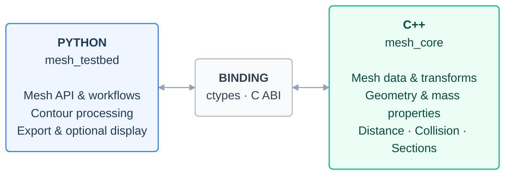

# MeshTestbed Portable: Background, Technical Approach, and Future Plans

> Update 2026-11-11: GitHub Actions native builds and all 82 tests passed on Windows, Linux, macOS ARM64 and macOS Intel (zero skips). See [CI_REPORT.md](CI_REPORT.md) for evidence and downloads. Earlier validation statements below are historical.

## 1. Background

This project aims to provide a portable, high-performance geometry library that can be called from Python, supporting future CAD, CAE, and CAM research, simulation workflows, and large-scale optimization.

The original project includes C++ and MATLAB implementations. C++ is well suited to intensive geometry computation, but the original C++ application is coupled to Visual Studio, MFC, and desktop rendering code, making setup and distribution cumbersome. MATLAB is effective for matrix operations and numerical prototyping, but its full development environment is substantial and involves license and toolbox management. Runtime requirements depend on the deployment method.

Here, “heavyweight” refers primarily to the original development environment, dependencies, and deployment process—not to C++ itself. C++ can be compiled into a small, standalone computational library. Vectorized MATLAB code can also be efficient; actual performance depends on the algorithm and implementation, rather than the language alone.

Python offers an accessible environment for writing experiments, processing data, and organizing batch jobs. It also provides a practical path toward deep learning, optimization, and automated research workflows. Since pure Python loops are not ideal for all intensive computations, the project uses the following division of responsibilities:

> C++ performs the core geometry computations; Python handles the interface, data processing, experiment orchestration, and future algorithm integration.

This architecture retains the performance advantages of native computation while simplifying everyday use and providing interfaces for future machine learning, simulation, and optimization workflows.

## 2. Technical Approach

### 2.1 Build an Independent C++ Computational Core

The original project is preserved. The required computational functionality is independently reimplemented in standard C++17 under `MeshTestbed_Portable`, separating computation from MFC windows and the legacy OpenGL display code.

The result is a new portable computational library, rather than a dynamic-library wrapper around every feature of the original application. Legacy menus, dialogs, and some auxiliary algorithms have not been migrated.

### 2.2 Compile Platform-Specific Dynamic Libraries

| Operating System | Dynamic Library | Current Build Targets |
|---|---|---|
| Windows | `mesh_core.dll` | x86_64 |
| Linux | `libmesh_core.so` | x86_64 |
| macOS | `libmesh_core.dylib` | Apple Silicon / Intel, built separately |

The compilation environment is configured on development or build machines. Users receive the package for their platform and place the Python modules and dynamic library together in their project. Visual Studio, MFC, and a compiler are not required to use the resulting package.

“Installation-free” means the computational library can be used after extraction. A compatible Python interpreter, operating system, and system runtime libraries are still required. Each operating system and processor architecture needs its own binary.

### 2.3 Connect Python and C++ Through a Defined Interface

The C++ library exposes a C ABI. Python loads the dynamic library using the standard-library `ctypes` module and wraps the underlying operations in a `Mesh` class.

Python manages object lifetimes, parameter conversion, errors, and call orchestration. C++ stores mesh data and performs the main computations, avoiding repeated file loading for every query. Spatial queries use a cached bounding volume hierarchy (BVH). Transforming a model invalidates the index, which is rebuilt when a subsequent query needs it.

Calls across the language boundary still have overhead, so batch queries are preferred. Retrieving mesh data in Python involves a copy. Zero-copy sharing with deep learning tensors and automatic differentiation interfaces are not currently implemented.

### 2.4 Separate Computation from Visualization

Core computation requires only the Python modules and native dynamic library, in addition to the compatible runtime environment. Visualization is optional: Python uses NumPy and Polyscope, with OpenGL rendering the mesh underneath.

This supports both desktop inspection and batch or server workloads that do not load the display module. OpenGL handles rendering; the current geometry algorithms execute in C++ on the CPU.

### 2.5 Implemented Features

| Category | Current Capabilities | Python Interface |
|---|---|---|
| Model input and output | ASCII and binary STL loading, construction from arrays, binary STL export | `Mesh`, `from_arrays`, `save` |
| Mesh data and topology | Vertex and triangle access, opposite halfedges, boundary and defect diagnostics | `counts`, `get_mesh`, `halfedges`, `metrics` |
| Basic geometric properties | Surface area, volume, bounding box | `area`, `volume`, `metrics` |
| Mass properties | Mass, centroid, and inertia tensor for uniform-density solids | `mass_properties` |
| Geometric transformations | Translation, rotation, scaling, general affine transformations | `translate`, `rotate`, `scale`, `transform` |
| Point-to-mesh queries | Batch nearest points, distances, signed distances, inside/outside classification | `nearest_points`, `classify_points`, `contains` |
| Relationships between models | Minimum surface distance, surface contact, solid containment detection | `distance_to`, `collision` |
| Sections and slicing | Arbitrary plane sections, multilayer slicing, contour stitching, area and perimeter of valid closed contours | `section`, `slices`, `Section` |
| Visualization | Optional 3D mesh viewing | `show` |

C++ computes section segments. Python stitches contours and calculates their area and perimeter. STL export is also implemented in Python.

Volume, mass properties, and solid classification require appropriate input meshes, including closure and consistent face orientation. Current diagnostics do not guarantee detection of every self-intersection or nonmanifold condition. Model-to-model distance measures surface separation: a model completely inside another can still have a positive surface distance, so this result should be interpreted alongside solid collision detection.

## 3. Architecture Diagram

Python provides the interface; C++ performs the core computations. A lightweight binding connects the two.



**Data flow:** Python sends parameters and receives results through the binding. Mesh data stays in C++ between calls.

**Deployment:** Windows `.dll` · Linux `.so` · macOS `.dylib`.

**Optional display:** Python → NumPy → Polyscope → OpenGL.

### 3.1 Usage Example

```python
from mesh_testbed import Mesh

with Mesh("part.stl") as mesh:
    print("Surface area:", mesh.area())
    print("Volume:", mesh.volume())
    print("Mass properties:", mesh.mass_properties(density=1.0))

    section = mesh.section(origin=(0, 0, 0), normal=(0, 0, 1))
    print("Section segments:", section.segments)

    # Optional: requires NumPy, Polyscope, and a desktop graphics environment.
    # mesh.show()
```

Coordinates and density must use consistent units. The library does not automatically infer length units from STL files. The volume and mass calculations above assume a solid mesh that meets the required conditions.

## 4. Validation Status and Scope

Existing test records show that all 67 tests passed in the Windows source environment. In an independent test of the extracted Windows distribution, 65 tests passed and two were skipped as expected because optional NumPy or the original project's test models were unavailable. Visualization was also verified through actual OpenGL rendering on Windows.

Linux and macOS libraries have been cross-compiled and their binary interfaces inspected, but native runtime testing on those systems remains pending. A cross-platform build workflow has been prepared; it still needs to be run and maintained on the target systems.

The library currently supports triangular-mesh geometry analysis and selected manufacturing preprocessing tasks. It does not yet provide STEP / IGES exact surface modeling, full Boolean operations, finite element solvers, complete toolpath planning, or G-code generation. Deep learning framework integration is also not yet implemented. See the [full test report (Chinese)](reports/full-test-2026-09-26/测试报告.md) for detailed evidence.

## 5. Future Plans

The following roadmap describes proposed work, not features that are already implemented.

### Phase 1: Complete Cross-Platform Delivery and Improve Reliability

- Complete native runtime validation on Windows, Linux, and both Intel and Apple Silicon macOS, and enable automated builds and regression tests.
- Document platform, Python version, and system runtime compatibility, and provide more convenient installation packages.
- Expand tests for large coordinates, small features, degenerate triangles, and tolerance boundaries, and establish reproducible performance benchmarks.
- Extend mesh validity checks to cover self-intersections, shell orientation, and nonmanifold conditions more comprehensively.

### Phase 2: Extend Mesh and Manufacturing Analysis

- Add explicit tolerance-based vertex welding, normal repair, hole handling, and mesh simplification.
- Improve slice contours, organization of data across layers, and section export.
- Add wall thickness, overhang angle, and manufacturability analysis according to practical requirements, with clear geometric definitions and applicability conditions.
- Investigate contour offsets and infill paths based on slicing results, followed by process-specific toolpaths and manufacturing output.

### Phase 3: Integrate Simulation and Optimization Workflows

- Use Python to organize parameter sweeps, design-variable updates, constraint checks, and result aggregation.
- Establish data exchange with external CAE solvers, explicitly distinguishing surface triangle meshes from volume meshes.
- Improve data transfer and parallel scheduling for batch optimization, adding parallel C++ algorithms where measured bottlenecks justify them.
- Use distance, collision, mass, and section metrics as optimization objectives or constraints in reproducible computational workflows.

### Phase 4: Integrate Deep Learning and Broader CAD Capabilities

- Organize geometry analysis results into training datasets for surrogate models, shape evaluation, or design-parameter prediction.
- Add array-to-tensor interfaces as needed. Gradient-based optimization would require separately designed derivative calculations or differentiable approximations.
- Evaluate an exact geometry kernel when required, extending STEP / IGES and surface/solid handling while assessing dependency size, licensing, and deployment costs.
- Consider GPU acceleration only when profiling demonstrates a need, avoiding premature increases in deployment complexity.

Implementation should prioritize native platform validation and mesh reliability, followed by manufacturing analysis, simulation interfaces, and learning models driven by concrete research needs.
